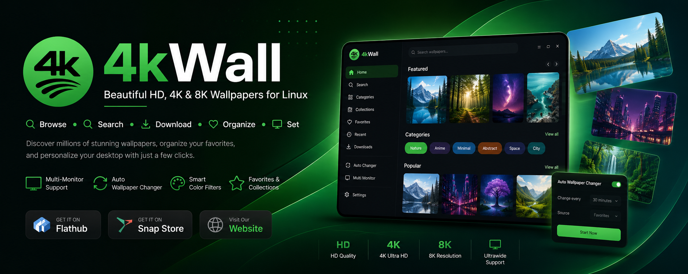
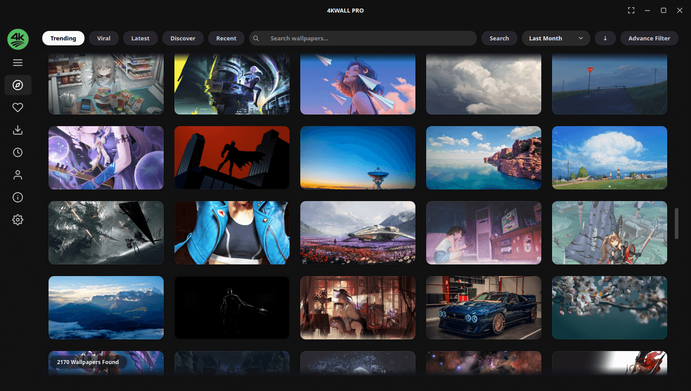
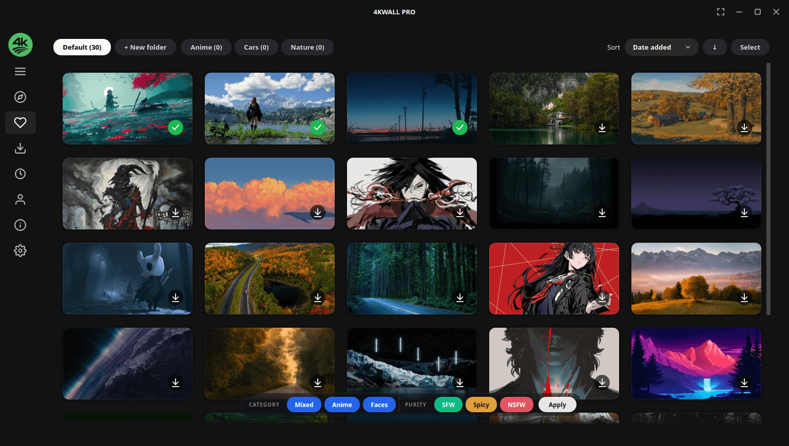
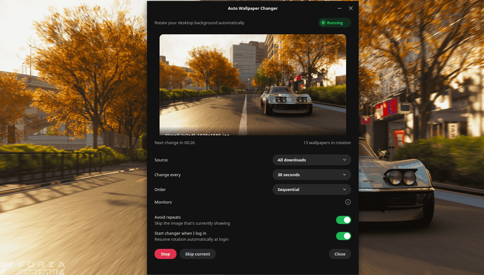
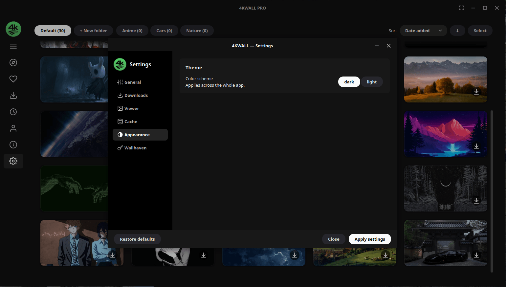

# 4KWALL — Wallpaper Manager & Auto Wallpaper Changer for Linux and Windows

**4KWALL is a desktop wallpaper app for Linux and Windows.** Browse and search millions of HD, 4K and 8K wallpapers, set them with one click, rotate them automatically on a timer, and run a different wallpaper on every monitor — all from a native app instead of a browser full of download traps.

<p align="center">
  
</p>

<p align="center">
  <a href="https://flathub.org/apps/details/com.warlordsoftwares.wallpaper-app-4kwall"></a>
  <a href="https://snapcraft.io/4kwall"></a>
  <a href="https://gitlab.com/warlordsoftwares/4kwall/-/releases"></a>
</p>

<p align="center">
  
  
  
  
  
</p>


---

## Contents

- [Download and install](#-download-and-install)
- [Features](#-features)
- [What you can do](#-what-you-can-do)
- [Screenshots](#-screenshots)
- [Desktop environment support](#-desktop-environment-support)
- [System requirements](#-system-requirements)
- [FAQ](#-faq)
- [How 4KWALL compares](#-how-4kwall-compares-to-other-wallpaper-apps)
- [More apps](#-more-apps-by-warlord-softwares)

---

## 📥 Download and install

<p align="center">
  <a href="https://snapcraft.io/4kwall"></a>&nbsp;
  <a href="https://flathub.org/apps/details/com.warlordsoftwares.wallpaper-app-4kwall"></a>&nbsp;
  <a href="https://gitlab.com/warlordsoftwares/4kwall/-/releases"></a>&nbsp;
  <a href="https://apps.microsoft.com/detail/9N305D02HC8C"></a>&nbsp;
  <a href="https://gitlab.com/warlordsoftwares/4kwall/-/releases"></a>
</p>

### Install on Linux (terminal)

```bash
sudo snap install 4kwall
```

```bash
flatpak install flathub com.warlordsoftwares.wallpaper-app-4kwall
```

### Install on Linux (AppImage — works on any distro)

Download the latest `.AppImage` from the [releases page](https://gitlab.com/warlordsoftwares/4kwall/-/releases), then:

```bash
chmod +x 4kWall-x86_64.AppImage
./4kWall-x86_64.AppImage
```

### Install on Windows (WinGet)

```powershell
winget install WarlordSoftwares.4kwall
```

Or get it from the **[Microsoft Store](https://apps.microsoft.com/detail/9N305D02HC8C)**, or download **[4kWall.exe](https://gitlab.com/warlordsoftwares/4kwall/-/releases)** from the [latest release](https://gitlab.com/warlordsoftwares/4kwall/-/releases).

---

## 🌟 Features

- **Millions of wallpapers, searchable** — browse a huge curated library of HD, 4K and 8K images without leaving the app.
- **Full-resolution downloads** — get the original file, not a resized thumbnail.
- **One-click set as wallpaper** — apply any image to your desktop instantly.
- **Auto wallpaper changer** — rotate wallpapers on a timer (every hour, every day, or your own interval), starting automatically at login.
- **Different wallpaper per monitor** — give each display in a multi-monitor setup its own image.
- **Smart search and colour filters** — filter by keyword, category, resolution, aspect ratio and dominant colour.
- **Favourite collections** — save and organise wallpapers into your own collections.
- **Ultrawide and high-DPI ready** — built for 21:9, 32:9, 1440p, 4K and 8K displays.
- **System tray integration** — change wallpapers without breaking your workflow.
- **Modern dark interface** — clean and distraction-free, with a light theme too.
- **No ads, no trackers.**

---

## 🎯 What you can do

| Task | How 4KWALL handles it |
|---|---|
| **Find a 4K wallpaper** | Filter the library by resolution and aspect ratio |
| **Change wallpaper automatically** | Set a rotation interval and a source collection |
| **Set a different wallpaper per monitor** | Assign images per display in a multi-monitor setup |
| **Find wallpapers by colour** | Filter by dominant colour to match your theme |
| **Build a wallpaper collection** | Favourite images and group them into collections |
| **Get an ultrawide wallpaper** | Filter by 21:9 or 32:9 aspect ratio |
| **Match your desktop theme** | Search by category — nature, minimal, abstract, anime, gaming, space, cars |
| **Download wallpapers in bulk** | Queue a collection and save it locally |

---

## 📸 Screenshots

| Explore | Favourites |
|---|---|
|  |  |

| Auto wallpaper rotation | Settings |
|---|---|
|  |  |

---

## 🖥️ Desktop environment support

4KWALL sets wallpapers on the major Linux desktops — **GNOME**, **KDE Plasma**, **XFCE**, **Cinnamon**, **MATE**, **Budgie** and **LXQt** — as well as **Windows 10 and 11**.

---

## 💻 System requirements

| | Minimum |
|---|---|
| **Linux** | Ubuntu 20.04+, Debian 11+, Fedora 36+, Arch, or any distro that runs Flatpak / Snap / AppImage |
| **Windows** | Windows 10 or Windows 11, 64-bit |
| **Architecture** | x86_64 |
| **RAM** | 4 GB |
| **Network** | Required for browsing and downloading wallpapers |

---

## ❓ FAQ

### Is 4KWALL free?

4KWALL is free to download and use. A one-time Pro upgrade unlocks the full feature set — there is no subscription. See [plans and pricing](https://warlordsoftwares.com/apps/plans-and-pricing/).

### Does 4KWALL work on GNOME and KDE Plasma?

Yes. It sets wallpapers on GNOME, KDE Plasma, XFCE, Cinnamon, MATE, Budgie and LXQt, plus Windows 10 and 11.

### Can it change my wallpaper automatically?

Yes. Pick a collection and an interval and 4KWALL rotates your wallpaper on schedule, resuming automatically after you log in.

### Does it support multiple monitors?

Yes — you can set a different wallpaper on each connected display, including mixed-resolution and ultrawide setups.

### Are the wallpapers full resolution?

Yes. Downloads are the original full-resolution files, up to 8K.

### Does it work on ultrawide monitors?

Yes. Filter by 21:9 or 32:9 aspect ratio to find wallpapers that fit without stretching or cropping.

### Is 4KWALL a Wallpaper Engine alternative?

Partly. Wallpaper Engine specialises in animated and interactive wallpapers; 4KWALL focuses on high-resolution still wallpapers with search, collections, auto-rotation and multi-monitor support — and it runs natively on Linux.

### Is 4KWALL open source?

No. 4KWALL is a proprietary desktop application. This repository hosts the releases, packaging metadata, issue tracker and documentation rather than the application source.

---

## ⚖️ How 4KWALL compares to other wallpaper apps

- **Wallpaper sites in a browser** (Wallhaven, Unsplash, Pexels) — great libraries, but you are stuck downloading, saving and setting each image by hand. 4KWALL does all three in one click and adds rotation.
- **Variety (Linux)** — free and scriptable, but dated and awkward to browse. 4KWALL gives you a modern searchable gallery with colour filters and per-monitor control.
- **Bing Wallpaper / Windows Spotlight** — one image a day, no choice. 4KWALL lets you pick the source and the schedule.
- **Wallpaper Engine** — the leader for animated wallpapers, Windows-only and Steam-bound. 4KWALL is the still-image counterpart that also runs on Linux.

---

## 🧩 More apps by Warlord Softwares

Other apps by Warlord Softwares are listed on [warlordsoftwares.com](https://warlordsoftwares.com/).

---

## 🔗 Links

- 🌐 **Website:** [warlordsoftwares.com](https://warlordsoftwares.com/trending-apps/4kwall-modern-wallpaper-app-with-auto-wallpaper-changer/)
- 📦 **Flathub:** [com.warlordsoftwares.wallpaper-app-4kwall](https://flathub.org/apps/details/com.warlordsoftwares.wallpaper-app-4kwall)
- 📦 **Snap Store:** [snapcraft.io/4kwall](https://snapcraft.io/4kwall)
- 🪟 **Microsoft Store:** [apps.microsoft.com/detail/9N305D02HC8C](https://apps.microsoft.com/detail/9N305D02HC8C)
- 🐞 **Issues:** [gitlab.com/warlordsoftwares/4kwall/-/issues](https://gitlab.com/warlordsoftwares/4kwall/-/issues)
- 🔒 **Privacy policy:** [privacy.html](https://warlordsoftwares.com/privacy-policy/)

---

## 📄 License

4KWALL is proprietary software. © 2024–2026 Rishabh Bhardwaj / Warlord Softwares. See [LICENSE](LICENSE).
